# Marber — Informe del segundo parcial

**Materia:** Aplicaciones Móviles · **Profesor:** Sergio Medina
**Integrantes:** Ezequiel Martínez Martínez · Tomás Sraiber

Marber es una app para registrar entrenamientos de gimnasio. Cada persona tiene su cuenta, arma sus rutinas con ejercicios de un catálogo con fotos, registra peso y repeticiones de cada serie mientras entrena y después consulta su historial, su progreso y sus estadísticas.

Está hecha en Android Studio con Java y XML. Usa Firebase Authentication para las cuentas y Cloud Firestore para guardar los datos de cada usuario.

## Mockups

Las láminas siguen el mismo formato que los mockups del primer parcial: una por pantalla, numeradas según el flujo de uso, con la pantalla montada en un marco de teléfono. Las pantallas se capturaron en un emulador Pixel 8 Pro con datos de prueba (cuenta, rutinas y entrenamientos de ejemplo). Todas están en [`docs/mockups/`](mockups/).

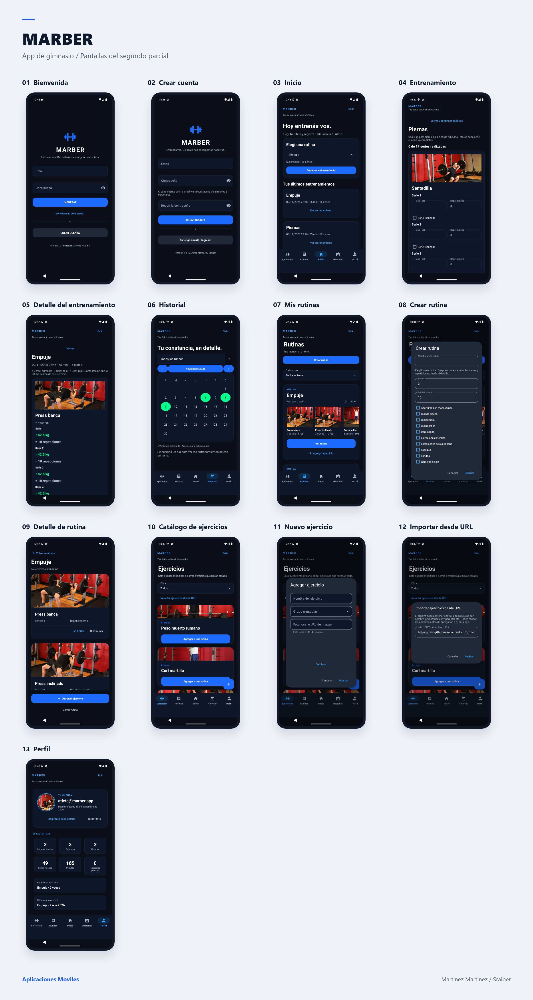

## Flujo general

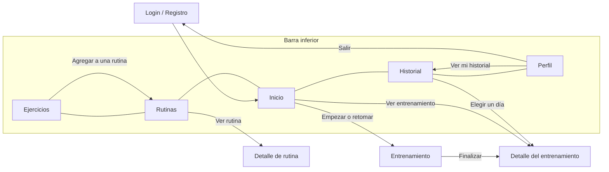

1. La persona se registra o inicia sesión. Al entrar por primera vez se le copian a su cuenta las rutinas predeterminadas de la app.
2. Desde **Inicio** elige una rutina y empieza un entrenamiento, o retoma uno que dejó pendiente.
3. En **Entrenamiento** carga peso y repeticiones, marca las series realizadas y agrega notas. Al finalizar, el entrenamiento pasa al historial.
4. En **Historial** ve los días entrenados en un calendario y abre el detalle de cada sesión, que compara los pesos con la vez anterior.
5. En **Rutinas** y **Ejercicios** arma y modifica sus rutinas y su catálogo personal.
6. En **Perfil** ve sus estadísticas, cambia su foto o su contraseña y cierra sesión.

La barra inferior queda fija: `HomeActivity` funciona como contenedor y cambia de Fragment según la pestaña elegida.

## Pantallas

### 1. Login y registro

| Login | Registro |
|---|---|
| 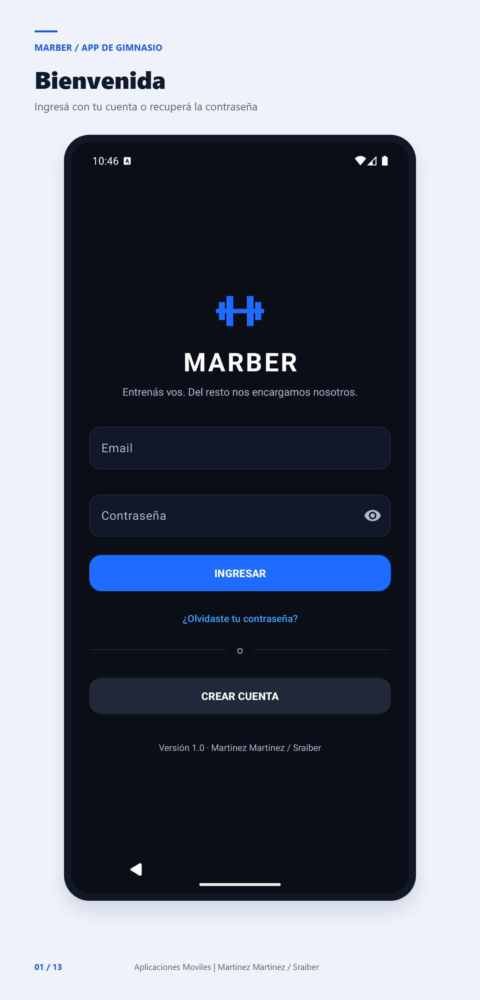 | 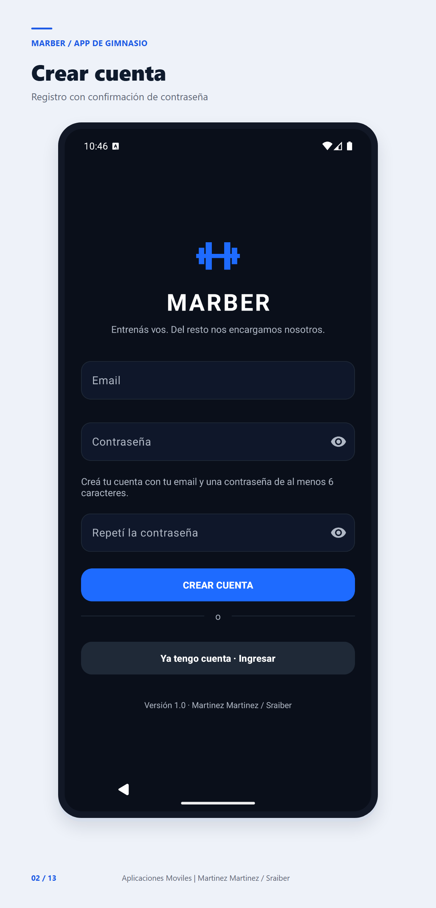 |

**Funcionalidades**
- Iniciar sesión con email y contraseña (Firebase Authentication).
- Crear una cuenta: el mismo formulario suma el campo para confirmar la contraseña.
- Recuperar la contraseña: pide confirmar el email y envía un enlace de recuperación.
- Valida los campos antes de enviar (email vacío o inválido, contraseña corta, confirmación distinta) y muestra los errores de Firebase en español.

**Flujo:** se completan los datos → se toca *INGRESAR* o *CREAR CUENTA* → la app espera la respuesta de Firebase con un indicador de carga → abre Inicio. Si ya había una sesión abierta, entra directo a Inicio.

### 2. Inicio

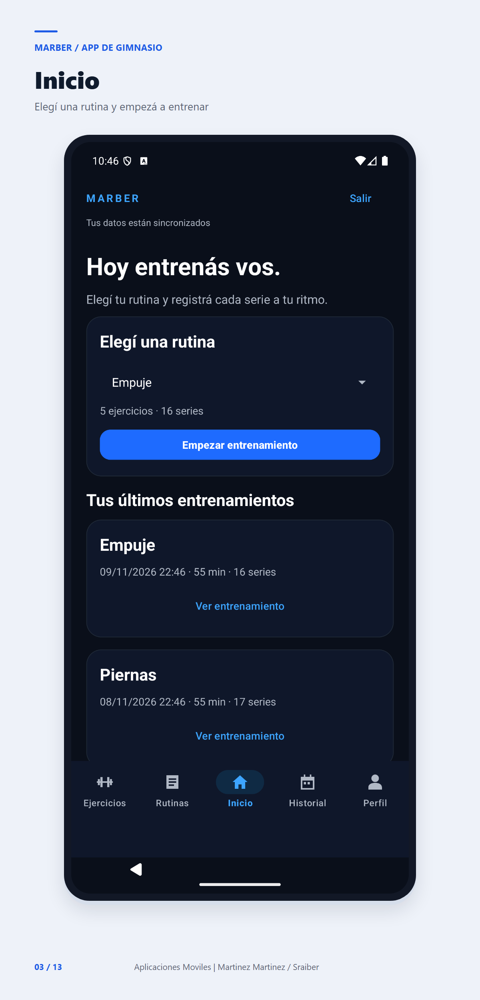

**Funcionalidades**
- Selector de rutina con la cantidad de ejercicios y series.
- Botón *Empezar entrenamiento*, o *Continuar entrenamiento* si hay uno sin terminar.
- Lista de los últimos entrenamientos con fecha, duración y series, y acceso a su detalle.

**Flujo:** se elige una rutina → *Empezar entrenamiento* → se abre la pantalla de Entrenamiento con el ID del entrenamiento como extra del Intent.

### 3. Entrenamiento

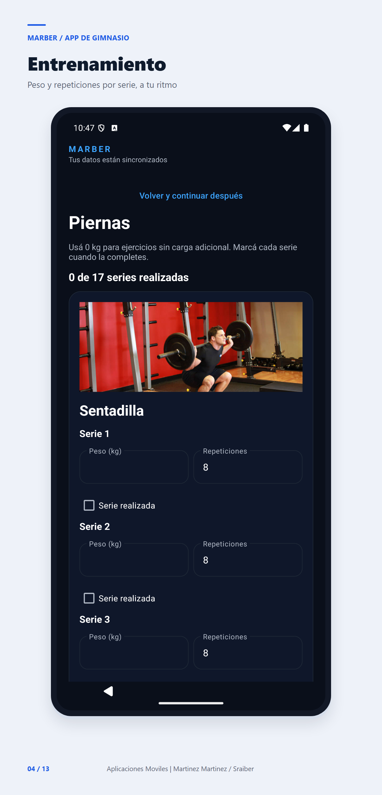

**Funcionalidades**
- Una tarjeta por ejercicio con su foto y sus series.
- Campos de peso y repeticiones por serie, casilla de *Serie realizada* y contador de series completadas.
- Notas por ejercicio y notas generales.
- El borrador se guarda en Firestore: se puede salir con *Volver y continuar después* y retomarlo, incluso desde otro dispositivo.
- Al finalizar se valida que todas las series estén completas y se pide confirmación.

**Flujo:** se cargan los datos de cada serie → se marcan como realizadas → *Finalizar entrenamiento* → se guarda en el historial.

### 4. Detalle del entrenamiento

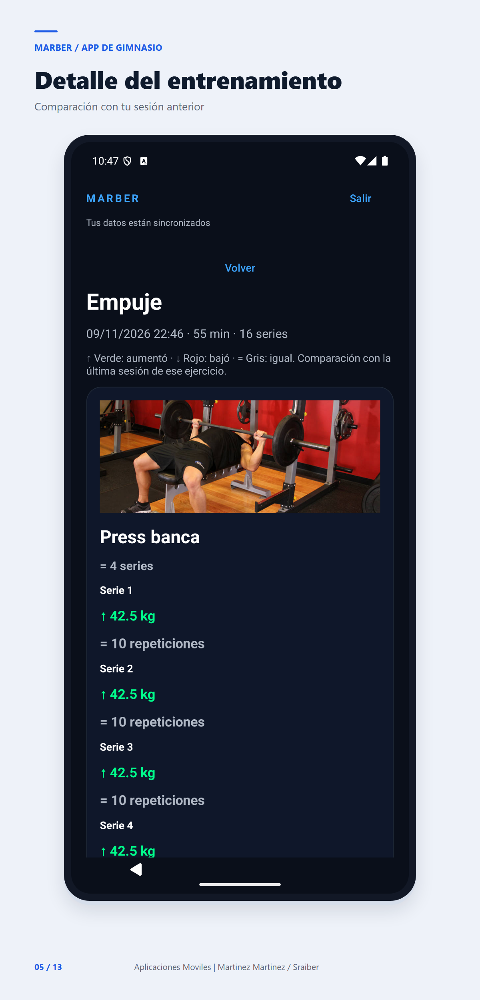

**Funcionalidades:** muestra cada ejercicio con sus series y notas, y compara peso y repeticiones con el registro anterior del mismo ejercicio.

**Flujo:** se abre desde Inicio, desde el Historial o al finalizar un entrenamiento. Recibe el ID del entrenamiento como extra.

### 5. Historial

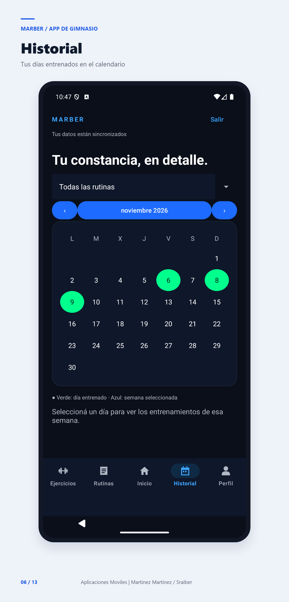

**Funcionalidades**
- Calendario mensual con los días entrenados marcados en verde.
- Filtro por rutina y navegación entre meses.
- Al tocar un día se marca su semana y se listan los entrenamientos de esa semana.

**Flujo:** se elige rutina y mes → se toca un día → se abre el detalle de un entrenamiento.

### 6. Rutinas, crear rutina y detalle de rutina

| Rutinas | Crear rutina | Detalle de rutina |
|---|---|---|
| 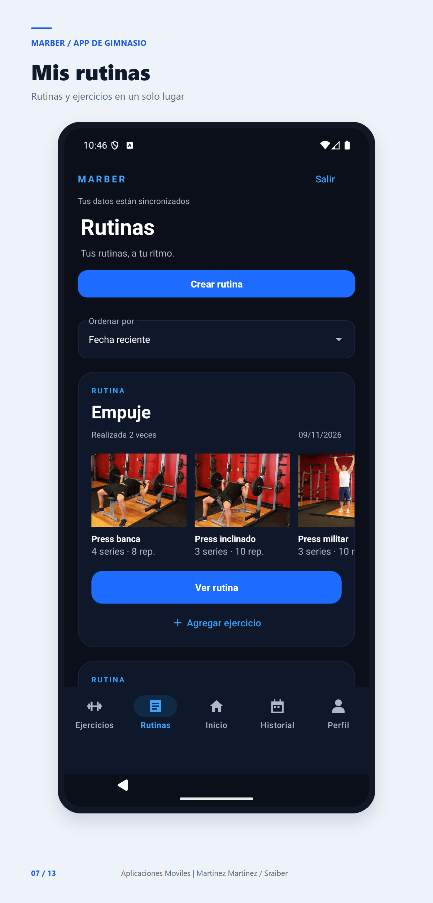 | 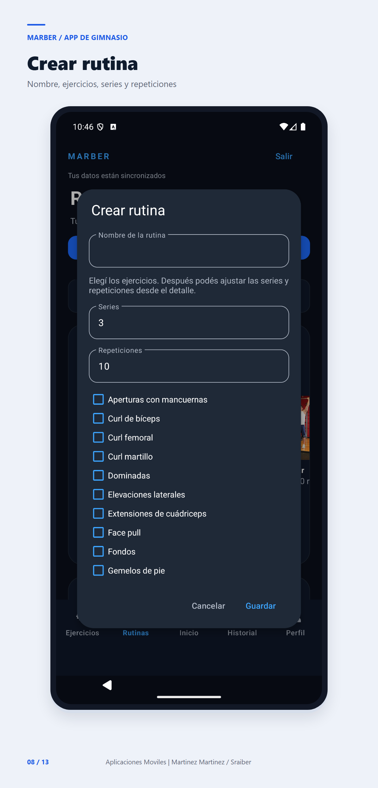 | 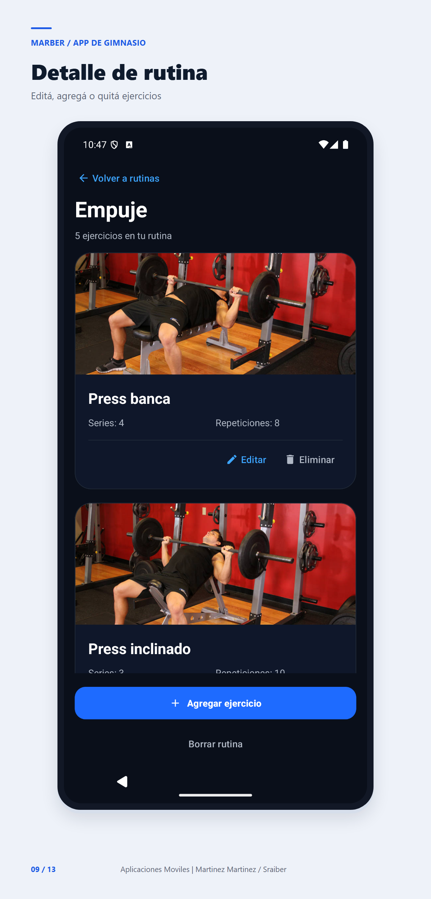 |

**Funcionalidades**
- Lista de rutinas con sus ejercicios en fotos, cantidad de veces realizada y fecha de la última vez, con orden configurable.
- *Crear rutina*: nombre, ejercicios del catálogo, series y repeticiones de cada uno.
- Detalle de rutina: agregar, editar y quitar ejercicios, y borrar la rutina, con confirmación.
- Cada cambio muestra un aviso de guardado o de error.

**Flujo:** *Crear rutina* → completar el formulario → *Guardar*. Para modificarla: *Ver rutina* → editar los ejercicios → los cambios se sincronizan con Firestore.

### 7. Ejercicios (catálogo), nuevo ejercicio e importación desde URL

| Catálogo | Nuevo ejercicio | Importar desde URL |
|---|---|---|
| 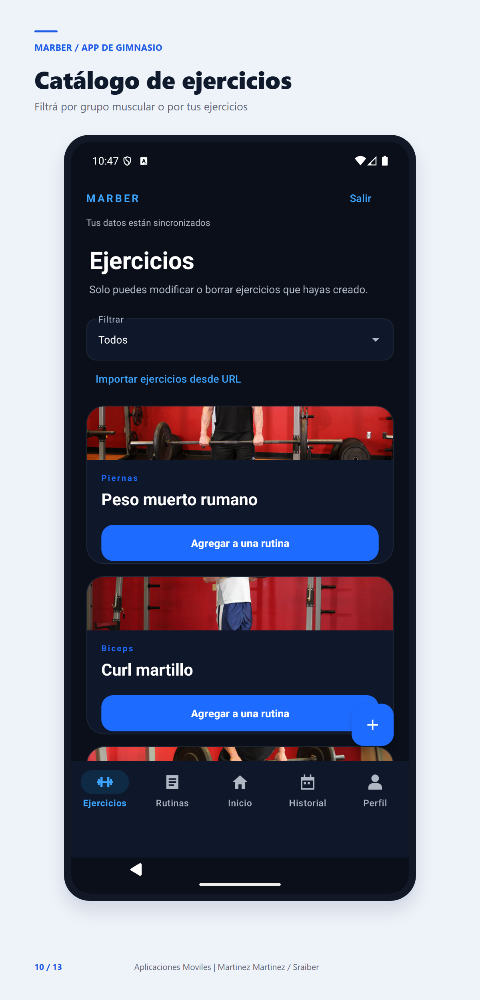 | 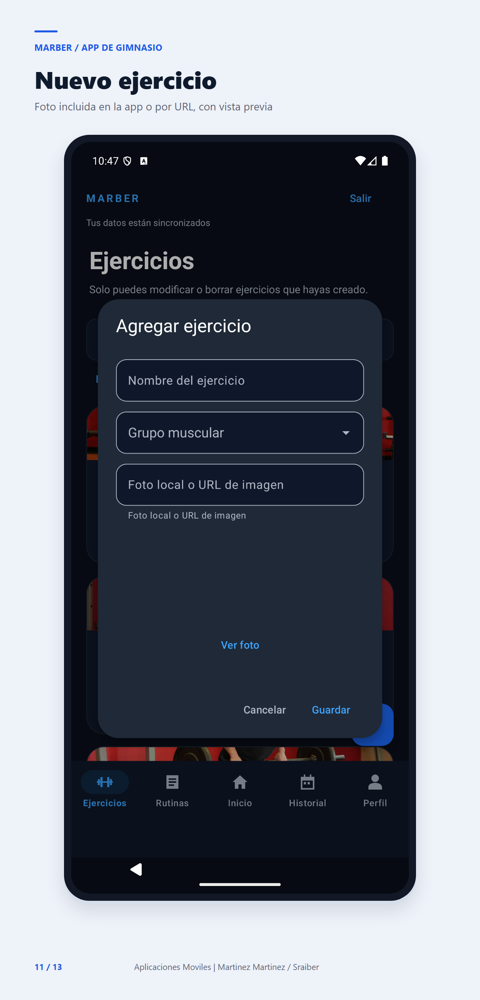 | 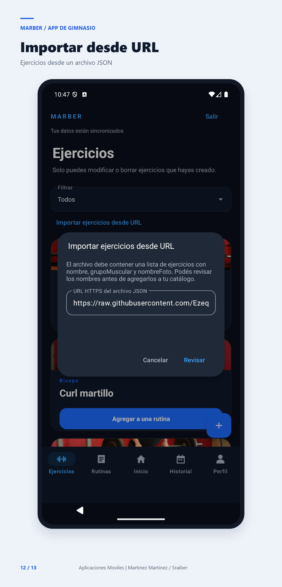 |

**Funcionalidades**
- Catálogo con foto, nombre y grupo muscular. Combina los ejercicios de la app con los creados por el usuario.
- Filtro por grupo muscular y por *Tus ejercicios*.
- Crear, editar y borrar ejercicios propios. El borrado pide confirmación y también quita el ejercicio de las rutinas que lo usaban.
- La foto puede ser una imagen incluida en la app o una **URL HTTPS**, con vista previa. Se descarga con **Glide**.
- **Importar ejercicios desde un JSON por URL** con **Volley**: se revisa la lista antes de agregarla al catálogo. El archivo de ejemplo es [`data/ejercicios.json`](../data/ejercicios.json) y sus fotos también se cargan desde URL.
- *Agregar a una rutina* desde cada tarjeta.

**Flujo:** *+* → completar nombre, grupo muscular y foto → *Ver foto* → *Guardar*. Para importar: *Importar ejercicios desde URL* → *Revisar* → *Agregar N ejercicios a mi catálogo*.

### 8. Perfil

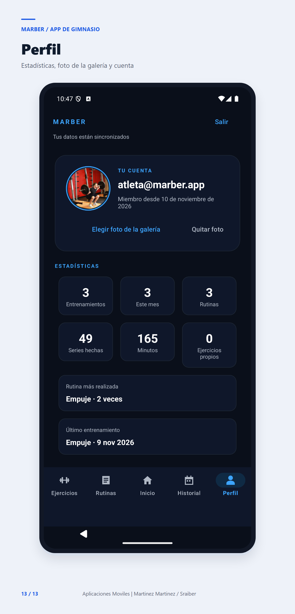

**Funcionalidades**
- Email de la cuenta y fecha de alta.
- **Foto de perfil elegida desde la galería** con el selector de fotos del sistema. Se guarda en el teléfono, separada por cuenta, y se puede quitar.
- Estadísticas: entrenamientos totales y del mes, rutinas, series hechas, minutos entrenados y ejercicios propios.
- Rutina más realizada y último entrenamiento.
- *Ver mi historial*, *Cambiar contraseña* (envía un enlace por email) y *Cerrar sesión* con confirmación.

**Flujo:** *Elegir foto de la galería* → se elige una imagen → la foto aparece en el círculo. *Ver mi historial* lleva a la pestaña Historial.

## Datos en Firestore

| Colección | Contenido |
|---|---|
| `ejerciciosPropiosDeLaApp` | Catálogo general (nombre, grupoMuscular, nombreFoto). Solo lectura. |
| `rutinasPredeterminadas` | Rutinas que se copian a cada cuenta nueva. Solo lectura. |
| `usuarios/{uid}/rutinas` | Rutinas del usuario. Cada ejercicio se vincula por `ejercicioId`. |
| `usuarios/{uid}/ejerciciosCreados` | Ejercicios propios del usuario. |
| `usuarios/{uid}/entrenamientos` | Entrenamientos finalizados. Guardan una copia del nombre y la foto para conservar el historial. |
| `usuarios/{uid}/estado/activo` | Borrador del entrenamiento en curso. |
| `usuarios/{uid}/estado/migracion` | Marca de que la cuenta ya recibió las rutinas predeterminadas. |

Las reglas de seguridad (`firestore.rules`) solo permiten que cada usuario lea y escriba sus propios datos.

## Cumplimiento de la consigna

| Requisito | Dónde está |
|---|---|
| Varias pantallas con navegación | Login, barra inferior con 5 secciones, Entrenamiento, Detalle de entrenamiento, Detalle de rutina |
| ConstraintLayout | `fragment_perfil.xml`, `fragment_ejercicios.xml`, `activity_detalle_rutina.xml`, `item_ejercicio_activity_ejercicios.xml` |
| LinearLayout vertical y horizontal | Formularios, tarjetas y grilla de estadísticas del Perfil |
| Button y TextView | En todas las pantallas |
| Contenido real con imágenes | Fotos de ejercicios de [free-exercise-db](https://github.com/yuhonas/free-exercise-db) (ver `docs/FOTOS_EJERCICIOS.md`) |
| Eventos y comportamiento dinámico | Series que se marcan, contador de progreso, rutinas y ejercicios que se agregan a las listas, filtros, calendario |
| Recursos organizados | `strings.xml` y archivos de textos por sección, `dimens.xml`, `colors.xml`, `styles.xml` |
| Pasaje de datos entre Activities con extras | `entrenamiento_id`, `rutina_id`, `nombre_rutina`, `seccion`, datos de sesión |
| Imágenes desde URL | Fotos de ejercicios por URL HTTPS con Glide |
| Contenido desde URL con una biblioteca | Importación de ejercicios desde JSON con Volley |
| Firebase Auth y Firestore | Registro, login, recuperación de contraseña y todos los datos del usuario |
| Convención de commits | Conventional Commits (`feat:`, `fix:`, `refactor:`) |
